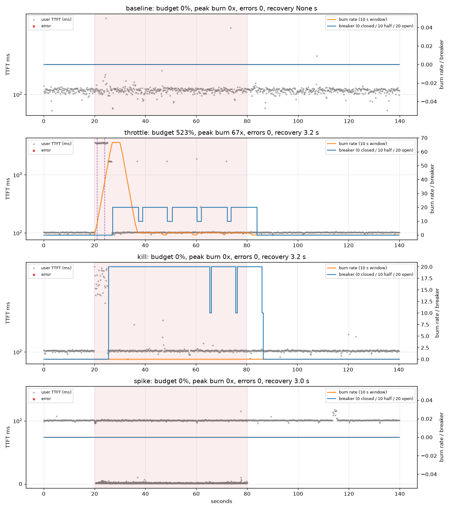
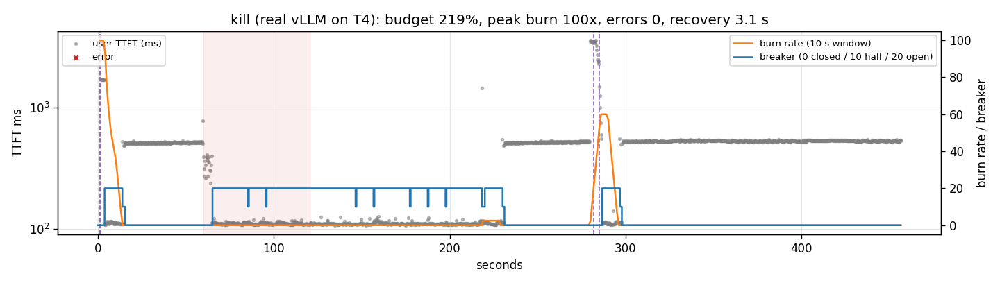

# inferchaos

Chaos engineering for LLM inference: inject GPU throttling, replica kills and traffic spikes, then measure SLO burn and recovery.

Project 14 of 15 in [inference-infra-portfolio](https://github.com/NomanJafar/inference-infra-portfolio).

## What this builds

Inject GPU throttling, replica kills and traffic spikes into a serving stack and measure SLO burn and recovery.

## Why it matters

Reliability is proven under failure, not in demos.

## Status

Done. Mock-provider suite and one live run on a T4 (a real vLLM replica killed and restarted mid-load) are written up below.

## What is in here

| Module | Purpose |
|---|---|
| `inferchaos.slo` | `SLO` (target + TTFT bound), good/bad events, burn-rate series over a window, budget consumed, multi-window alerts (page / ticket), recovery time |
| `inferchaos.experiment` | `Providers` (tokenbench mock servers as subprocesses: throttle at runtime, kill, restart), `Experiment` (llmgateway in a thread, steady open-loop load recording one SLO event per request, fault window, breaker-state sampling, summary) |
| `inferchaos.report` | Per-fault timeline (user TTFT, burn rate, breaker state, alerts) and the comparison table |
| `notebooks/kaggle_inferchaos.ipynb` | The same experiment with a real vLLM replica on a T4 as provider p0, killed with SIGKILL and restarted with its real cold start |

Ten tests; the four fault experiments run end to end (about 80 s) against live mock providers behind the real [llmgateway](https://github.com/NomanJafar/llmgateway).

## Usage

```bash
pip install "git+https://github.com/NomanJafar/inferchaos"
inferchaos run --out results/mock --rate 6 --baseline 20 --fault 60 --recovery 60
```

## Results: mock providers behind llmgateway (6 req/s, SLO: success and TTFT ≤ 800 ms at 99%)

Two providers in the chain (`p0`, `p1`), 16 concurrent requests each, 40 ms TTFT; gateway: first-token timeout 1.6 s, breaker on TTFT p95 / error rate over a 15 s window with 10 samples minimum and a 10 s cooldown; alert rules scaled to the experiment (page: 14.4x over 30 s and 5 s; ticket: 3x over 60 s and 10 s). Each run: 20 s baseline, 60 s fault on `p0`, 60 s recovery. "Budget consumed" is relative to the budget of the whole 140 s run, so 523% means the fault burned five runs' worth.

| fault | requests | errors | 429s | budget consumed | peak burn rate | alerts fired | breaker opened after | slow before breaker | fallbacks | recovery |
|---|---|---|---|---|---|---|---|---|---|---|
| baseline | 840 | 0 | 0 | 0% of the run's budget | 0x | none | – | 0 | 0 | – |
| throttle | 841 | 0 | 0 | 523% of the run's budget | 67x | ticket @ 1s, page @ 4s | 7.1 s | 40 | 44 | 3.2 s |
| kill | 842 | 0 | 0 | 0% of the run's budget | 0x | none | 5.6 s | 0 | 36 | 3.2 s |
| spike | 3361 | 0 | 2324 | 0% of the run's budget | 0x | none | – | 0 | 0 | 3.0 s |



### What the numbers say

1. **The slow provider is the dangerous one; the dead one is harmless.** Killing `p0` produced **zero** user-visible errors and burned **no** budget: every connection failed instantly, the gateway retried and fell back within a few hundred milliseconds, and the error-rate breaker opened 5.6 s in. Throttling `p0` to a 2 s TTFT burned 523% of the run's budget at a peak burn rate of 67x: 40 requests were slow before the TTFT breaker opened 7.1 s into the fault, because each of them had to wait the full 1.6 s first-token timeout before falling back, and until ten of them had done so the breaker had no grounds to act. Nygard's "slow dependencies hurt more than dead ones" is the measured difference between 0% and 523%.
2. **The breaker's probing is visible and costs a little each time.** In the throttle panel the breaker half-opens every 10 s cooldown, sends one probe, sees a 2 s TTFT and re-opens; each probe is one slow user request (the isolated dots at ~1.7 s). Fewer, more expensive probes versus faster recovery is the cooldown trade-off, and it shows as a cost per cycle here.
3. **Recovery was immediate in every case** (the 3 s figure is the floor of the metric: three seconds of sustained good events are required to declare recovery). Once the throttle lifted, the next probe succeeded and the breaker closed within one cooldown; once the killed provider was restarted, nothing changed for users because traffic was already on `p1`.
4. **Rate limiting turned the spike into 2,324 rejections and zero budget burn.** The admitted requests never left the 100 ms band. Whether a 429 is better than a slow answer is a product decision, but it is the decision that keeps the SLO, and the experiment shows the two outcomes do not mix: budget is burned by admitted-and-slow, not by rejected.
5. **The alerts fired fast because the burn was extreme** (ticket at 1 s, page at 4 s after the throttle began, against 30–60 s long windows): a 67x burn fills a long window's threshold in a fraction of the window. At a realistic 2–5x burn the long window would take minutes to fire, which is the point of the multi-window design.
6. **One gateway bug was found and fixed by this experiment:** the user-facing TTFT header reported the successful attempt's TTFT (40 ms on the fallback), hiding the 1.6 s the user actually waited on the throttled provider; the first throttle run therefore burned no budget at all. The header is now end-to-end and the per-attempt figure is separate. That is the kind of thing chaos testing is for.

## Results: killing a real vLLM replica on a T4 (run 4, 18 Oct 2026)

Same gateway and rules, with `p0` replaced by a real vLLM 0.31 instance (Qwen2.5-1.5B-Instruct fp16 on a Kaggle T4; first cold start 161 s) and `p1` the mock. 4 req/s, 32-token answers, SLO: success and TTFT ≤ 800 ms at 99%. 60 s baseline, `p0` killed at 60 s (SIGKILL of the whole process group), restarted as soon as the GPU memory was free, then 240 s of recovery. Raw timeline in [results/kaggle_run4/kill_real_vllm.json](results/kaggle_run4/kill_real_vllm.json).

| requests | user errors | fallbacks | retries | breaker opened after the kill | GPU memory released | restart to `/health` | traffic back on vLLM | budget consumed | peak burn | alerts |
|---|---|---|---|---|---|---|---|---|---|---|
| 1,827 | **0** | 65 | 50 | 5.1 s | 0.58 s | 95.9 s | 171 s after the kill | **219 %** | 100x | page + ticket, twice |



Reading the picture left to right: the real T4 answers at ~510 ms TTFT (the plateau), the mock at ~110 ms. At 60 s the kill empties the plateau; the gateway retries, falls back, and opens the breaker 5.1 s later; the breaker probes every 10 s and each probe fails until the restart; at 171 s the first probe after the restart succeeds and traffic returns to vLLM. Two things in the picture are not the kill: the burst of 3.5 s TTFTs at the very start, and the second burst at 220–230 s.

### What the numbers say

1. **The kill itself burned nothing.** During the 60 s fault window there were 243 requests and **0** bad events: every connection to the dead replica failed in milliseconds, the retry went to `p1`, and users got *faster* answers (110 ms from the mock against 510 ms from the T4). This is the mock experiment's result reproduced with a real process: a dead dependency is the easy case.
2. **The restart worked because the whole process group died.** Run 3 killed only the API server; its EngineCore child kept 12.9 GiB and the replacement found 1.6 GiB free. With `VllmServer.kill()` signalling the group, the GPU memory was released in 0.58 s and the new instance was healthy 95.9 s later (weights already on disk; the first start took 161 s). That delay is the recovery cost of a replica kill, and nothing in the gateway can shorten it: only a warm standby ([gpuscaler](https://github.com/NomanJafar/gpuscaler)) does.
3. **The budget was burned by the cold replica, twice, not by the dead one.** Every bad event in the run (15 in the first 10 s, 23 between 220 and 230 s) is a 3.5 s TTFT from a vLLM instance that had just started serving. vLLM's own log names the cause at exactly those moments: `Triton kernel JIT compilation during inference: kernel_unified_attention` and three top-p sampling kernels, "this causes a latency spike; consider extending warmup". The first time it hit the baseline (the notebook sent no warm-up traffic, a defect of this run, and the reason the alerts fire at t = 1 s); the second time it hit 60 s after the restarted replica took traffic, when a request shape it had not yet compiled for arrived. Both times the TTFT breaker opened within 4–11 s and the page and ticket alerts fired, because at 4 req/s a few 3.5 s answers are a 100x burn against a 1 % budget.
4. **"Ready" is not "warm".** `/health` returned 200 at 156.6 s; the first user request after that would still have taken seconds. A chain that admits a replica on readiness alone pays the JIT in user latency; the fix is a warm-up pass (a handful of requests across the prompt and batch shapes the service uses) between readiness and admission, which is what vLLM's warning asks for and what the breaker here did crudely by probing. Run 4 turned a planned experiment about failure into a measurement of the cost of recovery, which is the better result.
5. **Recovery time was 3.1 s each time** (the metric's floor: three seconds of sustained good events), because the fallback provider was healthy throughout. The user-visible recovery from the kill was instant; the system's recovery was 171 s.

## Layout

```
CONCEPTS.md     the theory behind the project, written before the code
src/inferchaos/   implementation
tests/          CPU-only tests, runnable on a laptop
notebooks/      GPU notebooks (Kaggle / Colab) that run the experiments and write results/
results/        measured numbers and plots
```

## Running

```bash
python -m venv .venv && source .venv/bin/activate
pip install -e ".[dev]"
pytest
```

GPU experiments run from `notebooks/`; each notebook clones this repo, installs it and writes its outputs to `results/`.

## Hardware notes

Developed against free-tier GPUs (Kaggle and Colab T4, 16 GB). Where a T4 limits what can be measured (no FP8, Turing-era kernels), the README says so rather than papering over it.

## License

MIT
